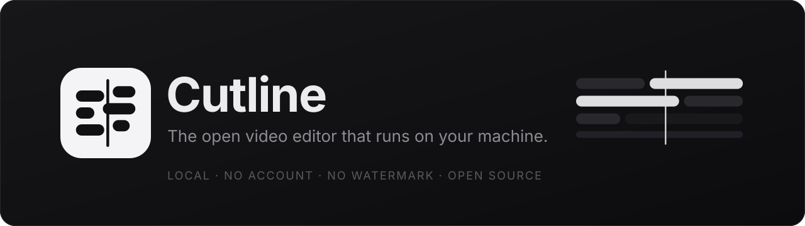
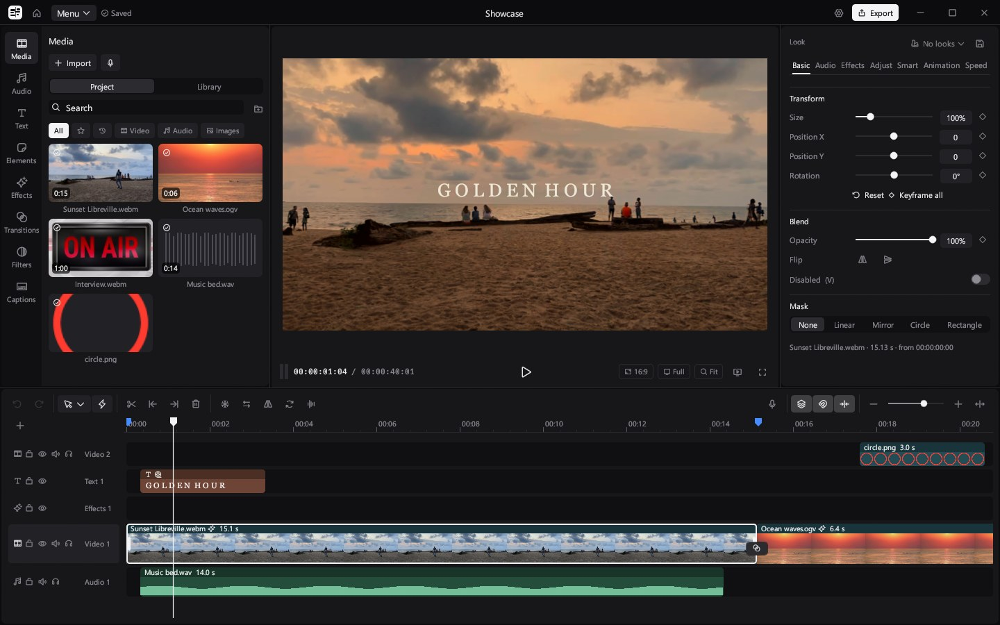
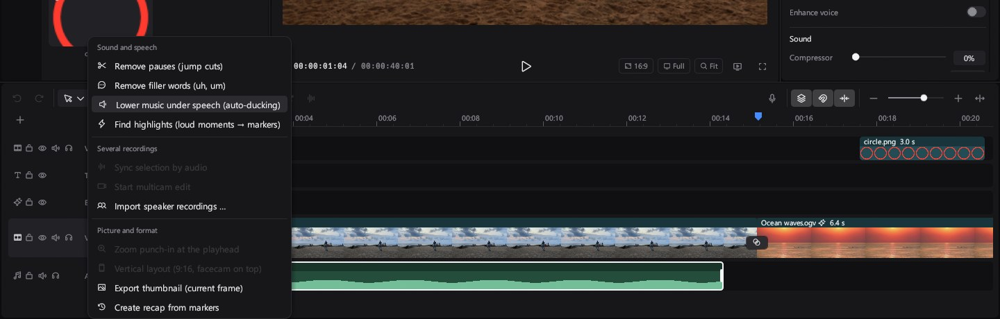
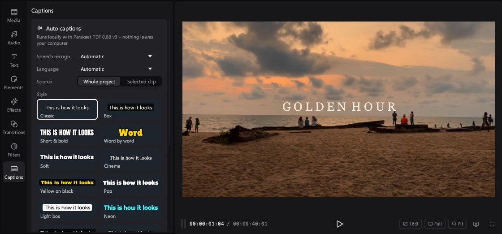
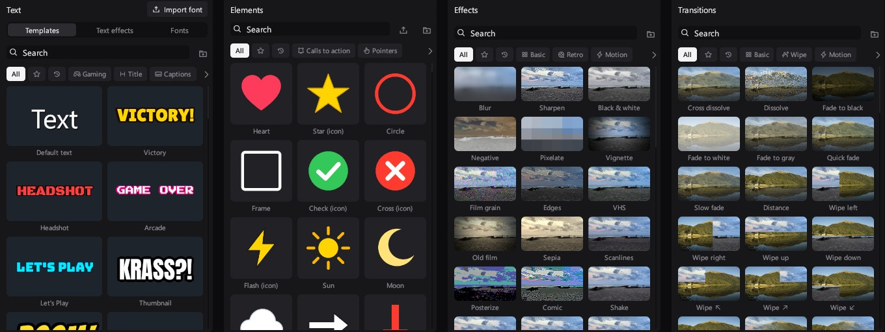
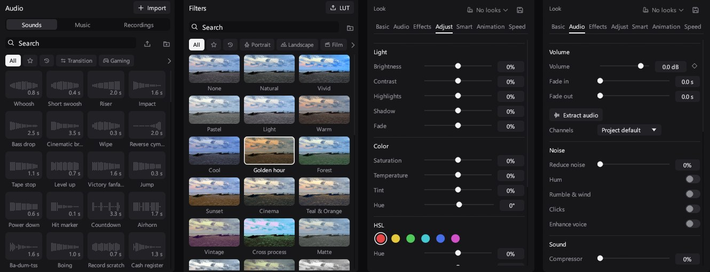
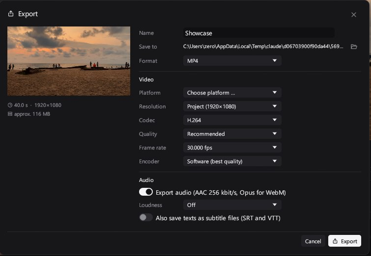

  

  <b>The open video editor for creators.</b> 
  Easy to use, fast, and entirely on your machine.

  
  
  
  

  <a href="https://github.com/zqqqqx/cutline/releases/latest/download/cutline-windows-x64-setup.exe"><b>Download for Windows</b></a> ·
  <a href="https://github.com/zqqqqx/cutline/releases/latest/download/cutline-linux-x64.zip"><b>Download for Linux</b></a> ·
  <a href="https://github.com/zqqqqx/cutline/wiki"><b>Guide</b></a> ·
  <a href="CHANGELOG.md">What's new</a> ·
  <a href="docs/ROADMAP.md">Roadmap</a>

  

## Why Cutline

<table>
  <tr>
    <td width="33%" valign="top">
      <h3>Simple</h3>
      A familiar layout: drag your footage in, cut, export. Every function is unlocked from the first start. Presets for YouTube, Shorts, TikTok, Reels and Twitch.
    </td>
    <td width="33%" valign="top">
      <h3>Fast</h3>
      Playback starts right away, also with large recordings: proxies are usable seconds after the import. Hardware encoders make exports quick.
    </td>
    <td width="33%" valign="top">
      <h3>Open</h3>
      No account, no subscription, no watermark, no ads. Local AI for captions, cut-outs and noise removal – nothing is uploaded; no generative AI.
    </td>
  </tr>
</table>

## Start in three steps

1. **Install.** Windows: run the [installer](https://github.com/zqqqqx/cutline/releases/latest/download/cutline-windows-x64-setup.exe) – it needs no admin rights and brings everything along. Linux: unpack the [zip](https://github.com/zqqqqx/cutline/releases/latest/download/cutline-linux-x64.zip) and run `./cutline` (needs FFmpeg 7 or newer on your system).
2. **Drag your files in.** Drop videos, images and audio from the file explorer straight onto the timeline.
3. **Cut and export.** Split with <kbd>Ctrl</kbd>+<kbd>B</kbd>, delete with <kbd>Del</kbd>, then pick a platform in the export window.

The [guide](https://github.com/zqqqqx/cutline/wiki) walks you through your first video and explains every part of the editor.

## One click for the tedious parts

The **Quick Actions** menu in the timeline does the work that usually eats an evening: remove pauses from talking
parts, cut filler words, lower music under speech, turn the loud moments of a long recording into markers, sync
several recordings by their audio and cut between them live, switch to a 9:16 layout with the facecam on top, or
save the current frame as a thumbnail.

## Captions without uploading anything

Automatic captions run on your computer, in 25 European languages with word timing, and in 99 languages with the
fallback model. Pick a style, from classic to word by word, and edit the text like any other clip. The same goes for
removing a background without a green screen and for cleaning up a noisy voice track.

## Everything to dress up a video

Text templates, stickers and animated elements, effects, filters, transitions, sound effects and music sit in one
library with search, favorites and your own folders. Add your own fonts, stickers, sounds and presets.

## Look and sound

Adjust light and color, load a LUT, mask, blend and animate with keyframes. For sound: fades, noise reduction,
voice enhancement, loudness for streaming platforms and voiceover recording.

## Export for every platform

Presets for YouTube (1080p, 1440p, 4K), Shorts/TikTok/Reels, Instagram and Twitch, with transparent video and
audio-only export. Cutline warns you when the project's aspect ratio does not match the platform.

## Plugins

Integrations ship with Cutline but stay **off** until you turn them on. Keys and sign-ins stay on your computer.

| Plugin | What it adds |
|---|---|
| Epidemic Sound | Music and sound effects in the Audio tab (your own account) |
| Freesound | Hundreds of thousands of Creative Commons sound effects with license info (free key) |
| Pexels | Free stock videos and photos in the Media tab (free key) |
| Story tools | Characters with name, color and portrait; dialogue boxes and name tags in one click |

## Everything Cutline can do

<b>Full feature list</b>

| | |
|---|---|
| **Timeline** | Multiple video, text, effect and audio tracks · drop files straight from the file explorer · track names, solo and clip color labels · markers with notes (copy as YouTube chapters) · In/Out range with loop · J/K/L shuttle · roll, slip, nudge and numeric timing · clip groups · paste attributes · main-track magnet (ripple) · snapping to clips, playhead and beats · marquee and multi-selection · copy/paste · freeze frame · reverse · speed 0.1–10× and speed curves · smooth slow motion with interpolated frames |
| **Player** | All layers live, picture-in-picture · drag, scale, rotate and crop with snapping · zoom 50–400 % · large player mode · preview in its own window for a second screen · audio meters · proxies in pieces for smooth playback of large recordings · automatic preview quality when the computer gets busy |
| **Quick Actions** | Remove pauses (jump cuts) · remove filler words · auto ducking · highlights as markers · sync recordings by audio · multicam editing (1–9 while playing) · speaker recordings import · zoom punch-in · vertical 9:16 layout with facecam · split screen and picture-in-picture layouts · thumbnail tool with cut-out person, outline and title · recap from markers |
| **Library** | One catalog for elements, sound effects, music, effects, filters, transitions, text templates, fonts and media: search, favorites, own folders, and every category can be moved, renamed or hidden · own stickers, sounds and presets · content packs you can switch on and off, with sources and licenses in one place ([THIRD_PARTY.md](THIRD_PARTY.md)) |
| **Look** | Adjustments (light, color, HSL per range, sharpness, vignette, grain) · filters · LUT (.cube) · masks (linear, mirror, circle, rectangle) · crop · censor areas (pixelate or blur) that follow a face or a plate · blend and opacity · video noise reduction · deflicker |
| **Motion** | Keyframes for position, scale, rotation, opacity and volume · in/out/combo animations · transitions between clips, including shader transitions (cube, whip pan, zoom blur, glitch) · animated elements (subscribe button, arrows, countdown, confetti) and animated emoji |
| **Text** | Templates and text effects · karaoke captions that highlight the spoken word · outline, box and shadow · auto wrap · imported fonts · SRT import/export |
| **Audio** | Waveforms · volume keyframes and fades · audio track per clip for files with several tracks · voiceover recording with countdown · noise reduction · voice enhancement · loudness to −14 LUFS · bass/treble · 13 voice changers · music folder and sound effects |
| **Local AI** | Auto captions with NVIDIA Parakeet TDT 0.6B v3 (25 European languages, word timing), with Whisper as the fallback · background removal without a green screen (RobustVideoMatting), with blurred or colored background and person outline · chroma key with eyedropper · stabilization · object tracking · auto reframe for 9:16 · scene detection · beat detection |
| **Export** | MP4, MOV, MKV, WebM, GIF · audio-only WAV, MP3, M4A, FLAC · H.264, HEVC, AV1, VP9, ProRes · hardware encoding with NVIDIA, Intel and AMD encoders or the encoder built into Windows · up to 4K · export queue for several versions in a row · split into numbered parts · target file size · another aspect ratio (9:16, 1:1, 4:5) with fill or fit · transparent video (ProRes 4444, VP9 with alpha) · SRT side file |
| **Projects** | Project overview with search, duplicate and trash · project templates · autosave and automatic backups with restore · relink missing media · archive a project with its files · guided import of projects from other editors |
| **App** | Skippable introduction and a guided tour · command search (Ctrl+K) for every command · Brand Kit for your colors, fonts and logo · customizable shortcuts (Cutline, Premiere-like, Resolve-like) · English and German interface · themes, accent color and adjustable interface size · built-in updater with "What's new" · log export for troubleshooting, without project names, file paths or keys |

## Help and feedback

- **Guide:** the [wiki](https://github.com/zqqqqx/cutline/wiki) covers installation, a first video, every area of the editor, shortcuts and troubleshooting.
- **Something does not work:** open an [issue](https://github.com/zqqqqx/cutline/issues/new/choose) and attach the log from **Settings → About Cutline → Export log**. It contains no project names, file paths or keys.
- **An idea:** feature requests are welcome as issues too. The [roadmap](docs/ROADMAP.md) shows what is planned.

## System requirements

| | |
|---|---|
| **Windows** | 64-bit Windows. FFmpeg and everything else is included. |
| **Linux** | x86-64 with FFmpeg 7 or newer installed (8 for Whisper captions). The FFmpeg of Debian 13 works; Ubuntu 24.04 and older are too old, and Cutline says so at startup. |
| **Graphics** | A graphics card helps with the preview, shader transitions and export, but is not required. |
| **AI models** | Not bundled. Download the ones you need under **Settings → Models (local AI)**. |

## For developers

Cutline is written in Rust and open source under the MPL-2.0. Building, testing and the rules for changes are in
[CONTRIBUTING.md](CONTRIBUTING.md), the structure of the code in [docs/ARCHITECTURE.md](docs/ARCHITECTURE.md).
Cutline can also be controlled by other programs over MCP – see
[Automation (MCP)](https://github.com/zqqqqx/cutline/wiki/Automation-MCP).

## License

Cutline is licensed under the [Mozilla Public License 2.0](LICENSE). FFmpeg, ONNX Runtime and the AI models are
separate programs and files under their own licenses; bundled content is listed in [THIRD_PARTY.md](THIRD_PARTY.md).

---

Footage in the screenshots: "Sunset timelapse on the beach in Libreville, Gabon" and "Ocean surface waves 06" from Wikimedia Commons, both CC0. Brand assets and guidelines: [`docs/BRAND.md`](docs/BRAND.md).
