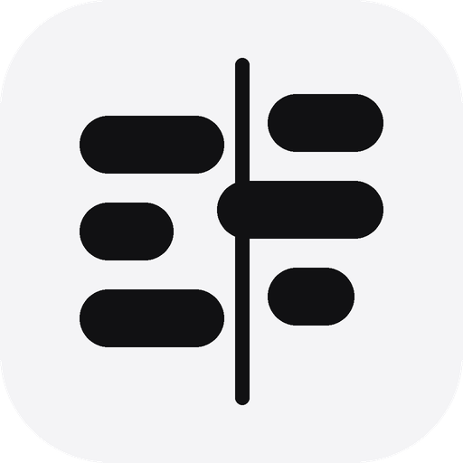
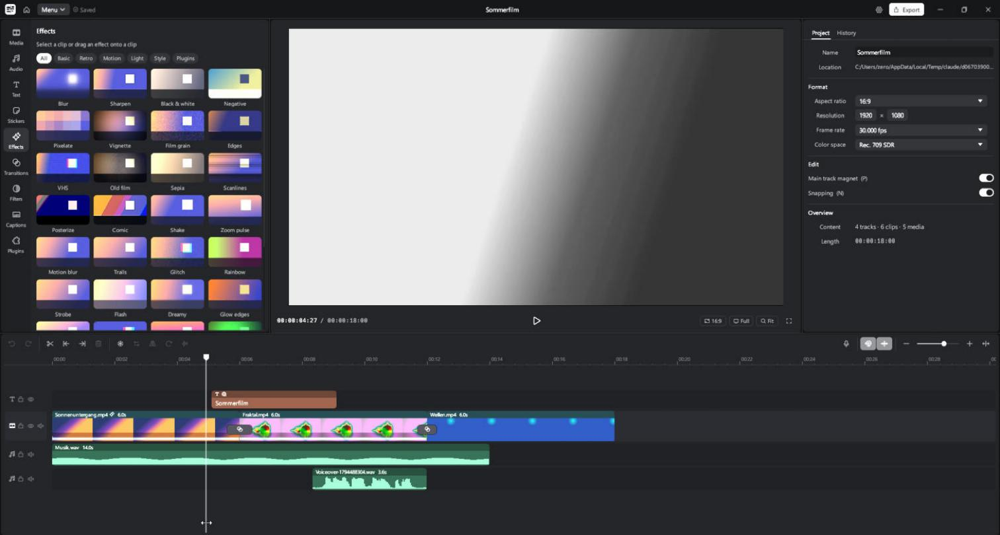

<p align="center">
  
</p>

<h1 align="center">Cutline</h1>

<p align="center">
  <b>A fast, local, open-source video editor written in Rust.</b><br>
  No account. No subscription. No ads. No cloud. Your footage stays on your machine.
</p>

<p align="center">
  <a href="https://github.com/zqqqqx/cutline/releases/latest"></a>
  <a href="https://github.com/zqqqqx/cutline/actions/workflows/ci.yml"></a>
  
  
</p>

<p align="center">
  
</p>

## Why Cutline

- **Everything runs locally.** Auto captions, background removal, tracking and beat detection run on your own computer with open models. Nothing is uploaded.
- **Edit fast.** A multi-track timeline with a main-track magnet, snapping, and split/trim shortcuts on single keys. You can also edit right in the player: drag, scale and rotate with guides.
- **Built-in creative library.** 34 effects, 22 filters, 49 transitions, keyframes, animations, masks, LUTs, stickers, sound effects and text templates. All of it is in the export too, exactly as previewed.
- **Bring your own fonts.** Import TTF, OTF, TTC and WOFF files directly, for one project or for all of them. Variable and color fonts are supported.
- **Scriptable.** A built-in [MCP](https://modelcontextprotocol.io) server lets assistants and scripts edit the open project. Every change lands in the undo history.
- **Honest software.** MPL-2.0, project files are plain JSON, and updates are verified with SHA-256 and installed only when you confirm.

## Features

| | |
|---|---|
| **Timeline** | Multiple video, text and audio tracks · main-track magnet (ripple) · snapping to clips, playhead and beats · marquee and multi-selection · copy/paste · freeze frame · reverse · speed 0.1–10× and speed curves · smooth slow motion with interpolated frames |
| **Player** | All layers live, picture-in-picture · drag, scale and rotate with snapping · zoom 50–400 % · large player mode |
| **Look** | Adjustments (light, color, HSL per range, sharpness, vignette, grain) · filters · LUT (.cube) · masks (linear, mirror, circle, rectangle) · blend and opacity · video noise reduction · deflicker |
| **Motion** | Keyframes for position, scale, rotation, opacity and volume · in/out/combo animations · transitions between clips |
| **Text** | Templates and text effects · outline, box and shadow · auto wrap · imported fonts · SRT import/export |
| **Audio** | Waveforms · volume keyframes and fades · voiceover recording with countdown · noise reduction · voice enhancement · loudness to −14 LUFS · bass/treble · 13 voice changers · music folder and sound effects |
| **Local AI** | Auto captions with NVIDIA Parakeet TDT 0.6B v3 (25 European languages, word timing), with Whisper as the fallback · background removal without a green screen (RobustVideoMatting), with blurred or colored background and person outline · chroma key with eyedropper · stabilization · object tracking · auto reframe for 9:16 · scene detection · beat detection |
| **Export** | MP4, MOV, MKV, WebM, GIF · audio-only WAV, MP3, M4A, FLAC · H.264, HEVC, AV1, VP9, ProRes · NVENC, Quick Sync and AMF hardware encoding · up to 4K · transparent video (ProRes 4444, VP9 with alpha) · SRT side file |
| **App** | Project overview with search, duplicate and trash · autosave · English and German interface · adjustable UI scale · built-in updater |

## Install

**Windows:** download `cutline-windows-x64-setup.exe` from the [latest release](https://github.com/zqqqqx/cutline/releases/latest). The installer needs no admin rights. It adds Cutline to the Start menu and opens `.cutline` files. FFmpeg and ONNX Runtime are included. A portable `cutline-windows-x64.zip` is available as well.

**Linux:** download `cutline-linux-x64.zip`, unpack it and run `./cutline`. You need FFmpeg 7 or newer (8 for Whisper captions) installed on your system.

AI models are not bundled. Download the ones you need under **Settings → Models**.

## Build from source

Requirements: Rust (stable), and FFmpeg plus FFprobe on your `PATH` (or set `CUTLINE_FFMPEG_DIR`). On Windows you also need the MSVC build tools; on Linux, the usual X11/Wayland and ALSA development packages.

```bash
cargo test --workspace
cargo run -p cl-app --release
```

For local captions and background removal, place an ONNX Runtime 1.31 library (`onnxruntime.dll` / `libonnxruntime.so`) next to the binary or in the models folder.

<details>
<summary>Environment variables</summary>

| Variable | Purpose |
|---|---|
| `CUTLINE_HOME` | Data folder (fonts, plugins, settings); default `%APPDATA%\Cutline` |
| `CUTLINE_MODELS` | Folder for AI models; default `CUTLINE_HOME/Models` |
| `CUTLINE_FFMPEG_DIR` | Folder containing `ffmpeg` and `ffprobe` |
| `CUTLINE_NO_UPDATE=1` | Don't check for updates on startup |
| `CUTLINE_UI_SCALE`, `CUTLINE_WINDOW_SIZE`, `CUTLINE_WINDOW_POS`, `CUTLINE_MAXIMIZED=1` | Window and scale for testing |
| `CUTLINE_MISSING_TR=file` | Debug builds: log UI strings that have no translation yet |

</details>

## Keyboard shortcuts

| Key | Action | Key | Action |
|---|---|---|---|
| Space | Play / pause | Ctrl+B | Split at playhead |
| Q / W | Delete left / right of playhead | Del | Delete selection |
| Ctrl+C / X / V / D | Copy / cut / paste / duplicate | Ctrl+Z / Ctrl+Shift+Z | Undo / redo |
| ← / → | One frame back / forward | Home / End | Start / end |
| P / N | Magnet / snapping | V | Disable clip |
| R | Voiceover | F | Large player |
| Ctrl+I / S / O / E | Import / save / open / export | Ctrl+wheel | Zoom timeline |

## Control Cutline over MCP

**Headless (stdio):**

```json
{ "mcpServers": { "cutline": { "command": "cutline", "args": ["--mcp", "/path/to/project.cutline"] } } }
```

**Running app (HTTP):** go to Settings → MCP interface and turn it on. The server listens only on `127.0.0.1` and requires a bearer token. It can be set to read-only. Use the copy button to get a ready-made client configuration.

## Project layout

See [`docs/ARCHITECTURE.md`](docs/ARCHITECTURE.md) for the crates, the preview and export pipelines, local AI, plugins, translations and the roadmap.

## Contributing

Issues and pull requests are welcome. Run `cargo test --workspace` and `cargo clippy --workspace` before you send a change. To add translations, edit `crates/cl-i18n/locales/ui.en.tsv`.

## License

Cutline is licensed under the [Mozilla Public License 2.0](LICENSE). FFmpeg, ONNX Runtime and the AI models are separate programs and files under their own licenses.
